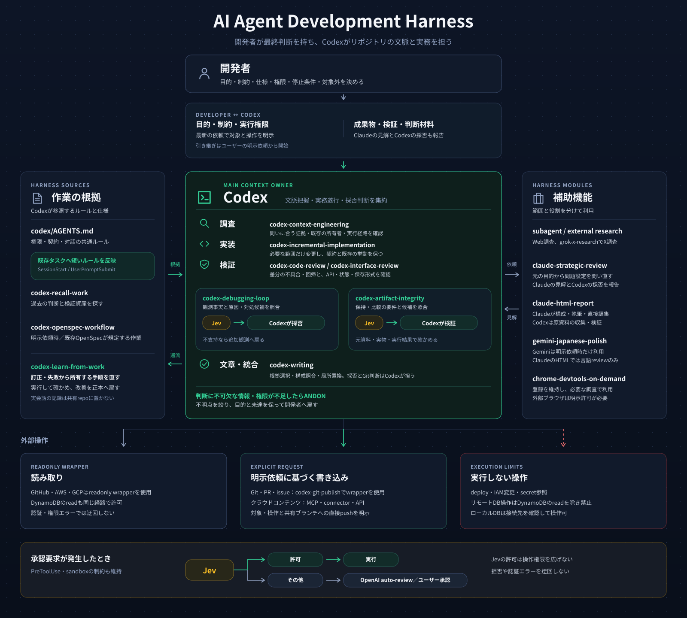

# AI Dev Harness

このリポジトリは、AIエージェントを実務開発の工程に組み込むための開発ハーネスです。リポジトリの文脈把握と実務を担う中心のエージェントとしてCodexを据え、開発者が目的、制約、事業文脈、仕様、権限、検証、停止条件、対象外を定義して最終判断を持ちます。

スキル、フック、専用コマンド、ラッパー、レビュー工程、テスト、OpenSpecなどの実行系へ、エージェントに期待する振る舞いを具体的に落とし込みます。その目的は、AIへ作業を丸投げすることではありません。開発者が主導権を持ち、エージェントが期待から外れたまま作業を進めにくい構造を作ります。

各プロジェクトで得られた失敗や改善点は、その場のログとして消費せず、顧客名、プロジェクト名、issue/PR番号、社内チャンネル名、秘密情報、生ログ、本番データ、固有パスなどを除外した上で、再利用可能な再発防止の仕組みへ反映します。

図中のskillを含む個別の役割・適用条件は、[Skill Map](codex/skills/README.md)にまとめています。

## Concept

AIエージェントは、既存コード、会話履歴、指示文、利用可能なツール、実行権限、テスト結果を入力として動作します。そのため、期待どおりの成果物を得るには、プロンプトの調整にとどまらず、エージェントが参照する文脈、実行可能なツール、通過すべきレビュー工程、作業を停止すべき条件までを設計する必要があります。

このリポジトリの基本的な考え方は、次のとおりです。

- **スキル（skill）**: 作業ごとの手順、判断基準、実行用スクリプトを提供します。長い資料から文章を作る場合は、現在の依頼、根拠の選択、構成の照合、生成を分け、既存原稿は修正箇所以外を保持します。
- **フック（hook）**: 秘密情報の露出、破壊的な変更、raw CLIの直接実行といった逸脱を検知します。また、開始・再開・文脈圧縮の後や運用ルールの更新時に、現在の短いルールを既存のタスクへ反映します。
- **専用コマンド・ラッパー（wrapper）**: Git、GitHub CLI、クラウド CLI などの実行経路を、用途ごとの専用コマンドに絞ります。
- **OpenSpec**: ユーザーが依頼した場合、または既存のOpenSpecが作業を規定している場合に使います。仕様、設計判断、実装タスク、検証条件を分けて管理します。
- **レビュー工程（review loop）**: 実装結果を仕様、差分、テスト結果、残存リスクに照らして検証します。失敗時にはJevで観測事実と原因・対処候補を照合します。文書や図などの成果物では、差分の意味、構造、実行時の動作に応じて必要な検証を選びます。PermissionRequestをJevで許可する基準を変える場合は、現在値と候補値をcalibrationとholdoutへ分けて比較します。いずれも結果の採否はCodexが決定します。
- **テスト・改善評価（test / evaluation）**: フックやラッパーの境界に加え、タスクの継続、原稿の保持、評価の入力・判定の整合を検証します。実会話で比較する場合は、問題直前までの文脈と同じ依頼・判定基準を使い、改善・回帰・未解決を残します。実会話と結果は私的領域に保管します。
- **レビュー可視化（review visualization）**: 依存関係、処理順序、状態遷移、比較軸、構造階層を、開発者が把握しやすい表現へ変換します。
- **会話の引き継ぎ（thread handoff）**: ユーザーの明示依頼を起点に、担当中のタスク全体を新しいタスクへ移します。全履歴の複製ではなく、目的、未達、判断、必要なファイルとOpenSpecを引き継ぎます。Codexから自発的には提案しません。

## Architecture

| 役割 | 位置づけ | 主な責務 |
| --- | --- | --- |
| Developer | 文脈と判断の起点 | 目的、制約、事業文脈、仕様、権限、検証、停止条件、対象外を決め、最終判断を行う |
| Codex（Main agent） | 実務を担う中心エージェント | リポジトリの文脈把握、実装、差分確認、テスト検証、PR説明文の作成、補助出力の採否と統合 |
| Skills | 作業手順と実行資産 | コンテキスト設計、デバッグ、レビュー、文章の根拠選択と局所置換、設計判断書、CDK設計レビューなど |
| Subagents | 範囲を限定した調査・独立レビュー | 影響範囲の調査、既存コードパターンの調査、仕様に照らした差分レビュー。採否判断とGit操作はCodexが担う |
| Strategic advisors | 問題設定と全体方針の独立した検討 | 元のユーザー目的と証拠から、解く問題、提案の方向、代替案、隠れたコストを問い直す。Claudeの見解とCodexの採否・理由を開発者へ区別して伝える |
| External research scouts | 範囲を限定した情報収集 | Web検索やXなどの外部情報源から最新情報と参照URLを収集する。事実確認と採否はCodexが担う |
| Artifact verification | 成果物に応じた検証 | Jevが変更内容から検証方針を振り分け、Codexが元資料、生成物、必要な実行結果に照らして採否を決める |
| Execution harness | 実行経路の制御 | ラッパー、ルール、フック、sandboxで操作を制御する。承認要求が発生した操作だけをPermissionRequest hookでJevが事前判定し、許可しない場合は通常の承認へ渡す。Jevの許可は既存の制約を迂回しない |

クラウドコンテンツの作成・編集・アップロードは、対象と操作を明示した依頼があればMCP、connector、APIから実行できます。Git・PR・issue操作は指定wrapperを使い、共有ブランチへの直接pushにはその操作の明示許可が必要です。deploy、IAM変更、secret参照、リモートDBの書き込み・削除・構成変更は実行しません。DynamoDBの読み取りはAWS readonly wrapper経由で許可し、その他のリモートDB操作は禁止します。接続先をローカルと確認したDBの起動・migration・テストは、これとは分けて扱います。権限の正本は[`AGENTS.md`](codex/AGENTS.md)と[`runtime-contract.md`](hooks/codex/runtime-contract.md)です。

## Review Visualization

文章だけでは、依存関係、状態遷移、処理順序、比較軸、構造階層を読み手が頭の中で組み立て直さなければならない場合があります。このハーネスでは、レビュー対象に応じてMarkdown表、Mermaid図、タイムライン、ツリー構造などを使い分けます。複数の図表を一つの画面で確認したい場合や、情報量と配置がレビュー精度に影響する場合は、`claude-html-report` などを使ってstandalone HTMLを作成します。

設計判断や仕様を可視化する場合は、Markdown、OpenSpec、code、schemaなどの元資料を正とします。レビューで採用した仕様変更は元資料へ反映し、可視化を更新します。`claude-html-report`でHTML資料そのものを作成する場合は、Claudeが構成・執筆と、対象HTMLへの直接の局所編集を担当します。Codexは元依頼・原資料を渡し、事実と表示を検証します。

可視化手法の選定基準と成果物の扱いは、[`review-visualization.md`](codex/skills/codex-frontend-ui/references/review-visualization.md) にまとめています。

## Repository Layout

- `codex/`: Codex向けの設定例、`codex/skills/*`、`codex/AGENTS.md`の構成要素
- `hooks/`: Codexの誤操作や逸脱を検知するローカルルール
- `wrappers/`: Git、GitHub CLI、AWS、Google Cloudなどへの操作経路を絞る専用コマンド
- `evals/`: Jevの判定基準、指示変更の影響、タスク継続、私的な実会話の再生を比較する評価入口
- `tests/`: フック、ラッパー、タスク継続、文章保持、評価器の契約を検証する回帰テスト
- `docs/`: 構成の考え方、失敗パターン、運用方法
- `assets/`: READMEや技術文書で使う図や画像。構成図は[SVG](assets/agent-development-harness.svg)を正本とし、[PNG](assets/agent-development-harness.png)は同じSVGから描画します。[生成用JSON](assets/agent-development-harness.prompt.json)にはその版の内容・グリッド・描画条件を記録します

## What This Repository Does Not Store

- 顧客名、プロジェクト名、issue/PR番号、社内チャンネル名などの固有情報
- トークン、認証情報、秘密情報（credential / secret / private key）、`.env`ファイル
- 障害ログ、会話ログ、本番データ（production data）の生情報
- 特定リポジトリのパス、ブランチ名、一時的な識別子に依存する個別ルール
- その場限りの回避策

## Operating Principle

AIエージェントによる失敗や改善点は、単なる作業ログとして残すのではなく、再発を防ぐ実行系（スキル、フック、専用コマンド、レビュー工程、テスト、OpenSpec）へ反映します。

- **仕様を推測で補完した場合**: 仕様に関する安全基準やレビュー用スキルに反映する
- **不要なフォールバックや過剰な後方互換性を追加した場合**: 停止条件に反映する
- **Gitやクラウド環境の操作で迷走した場合**: ラッパー、フック、実行ルールに反映する
- **読みにくい文章や不自然な記述を出力した場合**: `codex-writing`や該当する作成スキルの手順・実行資産を直し、同じ依頼で確かめる。Geminiは明示依頼時に利用し、Claude所有のHTMLでは言語レビューだけを返す
- **共有環境で壊れやすい変更を試みた場合**: 専用の設計レビュースキルに反映する

AIエージェントの運用を個人のプロンプト技術に依存させず、期待する振る舞いを継続的に保守できる開発資産として扱います。
